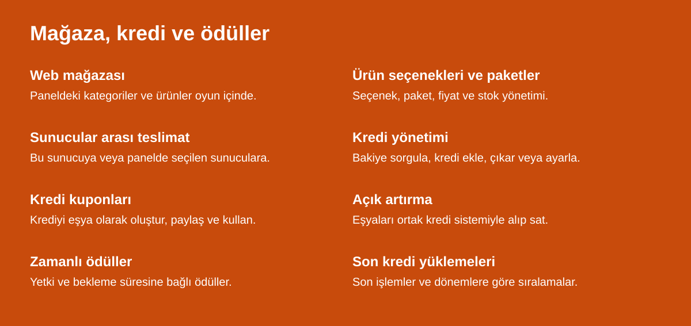
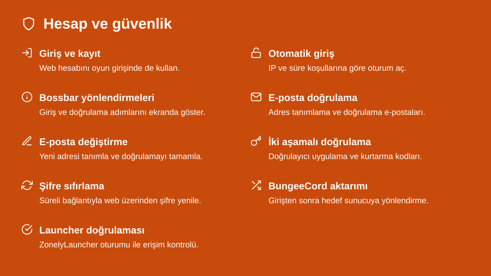
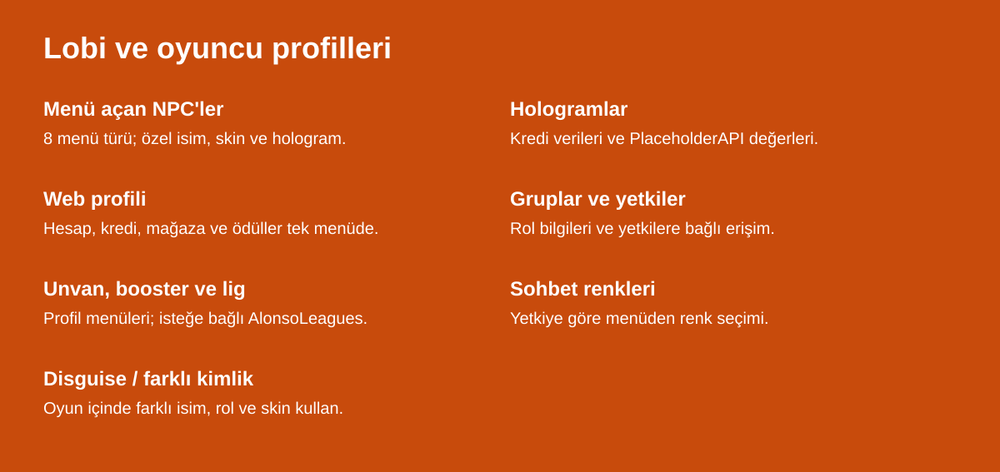
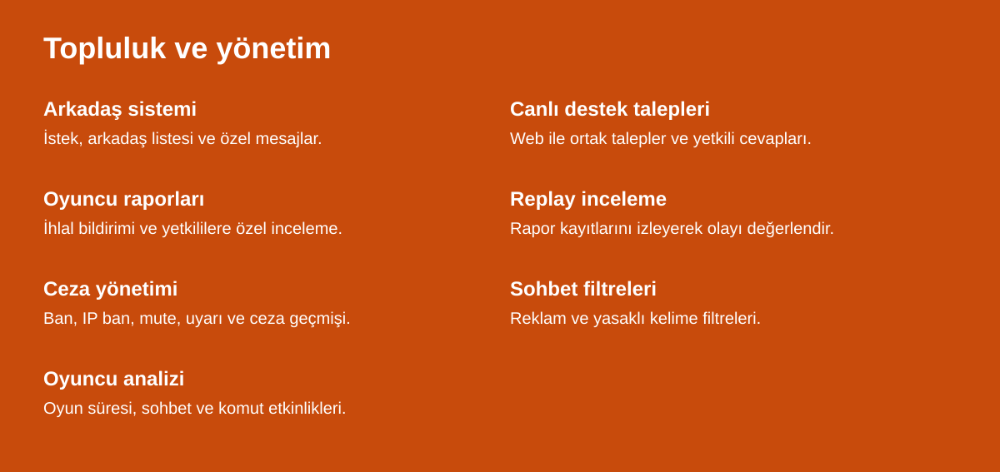
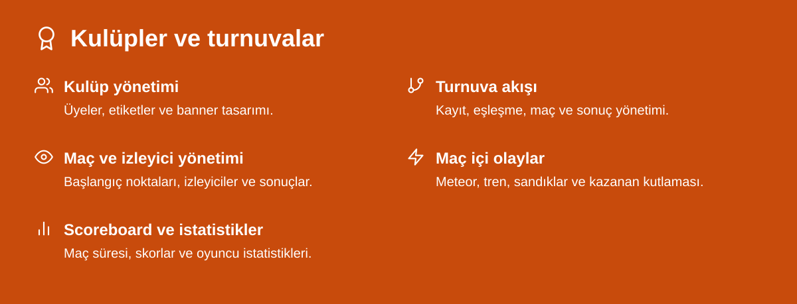
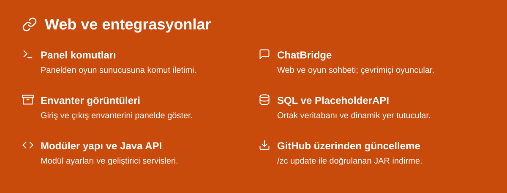
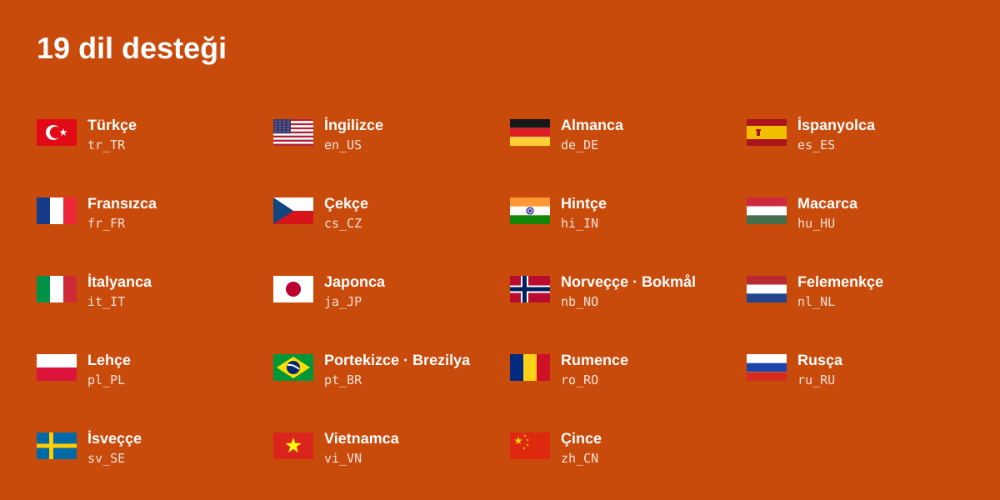

Minecraft sunucun ile Zonely web panelini bağla; mağaza, hesaplar, oyuncular ve turnuvaları birlikte yönet.

[JAR indir](https://github.com/zonely-gen-tr/ZonelyCore/releases/latest) · [Kurulum](docs/KURULUM.md) · [Mağaza](docs/MAGAZA.md) · [API](docs/ZonelyCoreAPI.md) · [SpigotMC](https://www.spigotmc.org/resources/zonelycore-one-core-for-minecraft.129652/) · [Destek](https://github.com/zonely-gen-tr/ZonelyCore/issues)













[Sistemlerin ayrıntıları](docs/SISTEMLER.md)



Varsayılan dil: `tr_TR`. Dil ve metinler `languages.yml` dosyasından düzenlenir.

## Kurulum

Zonely web paneli, MySQL/MariaDB, ProtocolLib ve PlaceholderAPI gerekir.

1. [JAR'ı indir](https://github.com/zonely-gen-tr/ZonelyCore/releases/latest) ve `plugins/` klasörüne koy.
2. `config.yml` içine panel veritabanı bilgilerini yaz.
3. Kullanacağın modülleri etkinleştir ve sunucuyu yeniden başlat.

**Mağazayı bağlayacaksan:** `web-token` alanına paneldeki bu sunucunun token değerini yaz; ürün ve teslimat komutlarını eşleştir. Genel kurulumda bu alanı doldurman gerekmez.

Test ortamı: **Paper 1.20.4 · Java 21 · ProtocolLib 5.4.0 · PlaceholderAPI 2.11.6**.

[Kurulum rehberi](docs/KURULUM.md) · [Mağaza ve sunucular arası teslimat](docs/MAGAZA.md) · [GitHub güncellemesi](docs/GUNCELLEME.md)

<details>
<summary>Komutlar ve NPC türleri</summary>

| Komut | Açıklama |
| --- | --- |
| `/zc` | Yönetim yardımı. |
| `/zc reload` | Dosyaları yeniden yükleme. |
| `/zc update` | GitHub'dan sürüm kontrolü ve indirme. |
| `/zc npc spawn <tür> [id]` | Lobi NPC'si oluşturma. |
| `/zc npc remove <tür> [id]` | Lobi NPC'sini kaldırma. |
| `/zc hologram lastcredits [id]` | Son kredi hologramını yerleştirme. |
| `/webprofile` | Oyuncu profil menüsü. |
| `/store` · `/magaza` · `/zonelystore` | Mağaza menüsü. |
| `/credit [oyuncu]` | Kredi bakiyesini sorgulama. |
| `/credit set <oyuncu> <tutar>` | Bakiyeyi belirleme. |
| `/credit add <oyuncu> <tutar>` | Kredi ekleme. |
| `/credit remove <oyuncu> <tutar>` | Kredi çıkarma. |
| `/creditvoucher <oyuncu> <tutar>` | Kredi kuponu oluşturma. |
| `/lastcredits` | Son kredi yüklemeleri ve sıralamalar. |
| `/auction <tutar>` | Eldeki eşyayı açık artırmaya koyma. |
| `/auctions` | Açık artırma menüsü. |
| `/report <oyuncu>` | Oyuncu raporlama. |
| `/reports` | Yetkili rapor menüsü. |
| `/punish` | Ceza menüsü ve alt komutları. |
| `/punish ban/ipban/mute/warning <oyuncu> <süre> <sebep>` | Ceza uygulama. |
| `/punish unban/unmute/unwarning <oyuncu>` | İlgili cezayı kaldırma. |
| `/support` | Destek talepleri. |
| `/friends` | Arkadaş menüsü. |
| `/friends add/accept/deny/remove <oyuncu>` | Arkadaşlık isteği ve liste yönetimi. |
| `/friends msg <oyuncu> <mesaj>` | Arkadaşa özel mesaj. |
| `/disguise` | Farklı kimlik menüsü. |
| `/club` · `/club help` | Kulüp menüsü ve komut yardımı. |
| `/esports` | Turnuva menüsü ve yönetimi. |
| `/login` · `/register` | Giriş ve kayıt. |
| `/email <set\|resend\|status>` | E-posta işlemleri. |
| `/passwordreset` | Şifre sıfırlama. |
| `/2fa <setup\|confirm\|cancel\|disable\|code\|recovery>` | İki aşamalı doğrulama. |

NPC türleri: `web-profile`, `auctions`, `last-credits`, `reports`, `deliveries`, `web-store`, `supports`, `tournaments`.

```text
/zc npc spawn web-store magaza
/zc npc spawn web-profile profil
/zc npc spawn tournaments turnuvalar
/zc hologram lastcredits krediler
```

</details>

<details>
<summary>Yetkiler</summary>

| Yetki | Kullanım |
| --- | --- |
| `zcore.admin` | ZonelyCore yönetimi. |
| `zonely.auction` | Açık artırma kullanımı. |
| `zonely.auction.manage` | Açık artırma yönetimi. |
| `zonely.reports.view` | Raporları görüntüleme. |
| `zonely.punish` | Ceza komutları. |
| `zonely.punish.ban` · `zonely.punish.ipban` | Ban ve IP ban. |
| `zonely.punish.mute` | Susturma. |
| `zonely.punish.warning` | Uyarı. |
| `zonely.punish.history` | Ceza geçmişi. |
| `zonely.punish.notify` | Ceza bildirimleri. |
| `zonely.support.staff` | Yetkili destek paneli. |
| `zonely.support.ban` | Destek erişimini yönetme. |
| `zcore.cmd.disguise` · `zcore.cmd.disguiselist` | Disguise ve kimlik listesi. |
| `esports.manage` | Turnuva yönetimi. |

</details>

<details>
<summary>PlaceholderAPI</summary>

Yer tutucular scoreboard, menü ve hologram eklentilerinde kullanılabilir. Son kredi alanlarında `<sıra>`, `1` gibi bir kayıt sırasıdır. Gösterilecek kayıt veya etkin turnuva yoksa ilgili değer boş dönebilir.

### Genel ve kredi alanları

| Yer tutucu | Değer |
| --- | --- |
| `%ZonelyCore_cash%` | Kredi bakiyesi. |
| `%ZonelyCore_perm%` | Oyuncu rolü/grubu. |
| `%ZonelyCore_playername%` | Gösterilen oyuncu adı. |
| `%ZonelyCore_status_delivery%` | Bekleyen zamanlı ödül bilgisi. |
| `%ZonelyCore_lastcredit_<sıra>%` | İlgili kaydın oyuncu adı. |
| `%ZonelyCore_lastcredit_<sıra>_display%` | Oyuncu ve yükleme tutarı. |
| `%ZonelyCore_lastcredit_<sıra>_name%` | Oyuncu adı. |
| `%ZonelyCore_lastcredit_<sıra>_amount%` | Yüklenen kredi. |
| `%ZonelyCore_lastcredit_<sıra>_date%` | Yükleme tarihi. |
| `%ZonelyCore_lastcredit_<sıra>_time%` | Yükleme zamanı. |

<details>
<summary>Turnuva, kulüp ve maç yer tutucuları</summary>

```text
%zonely_tournament_name%
%zonely_tournament_state%
%zonely_tournament_event%
%zonely_tournament_start%
%zonely_tournament_end%
%zonely_tournament_club_count%
%zonely_tournament_countdown%
%zonely_tournament_countdown_seconds%
%zonely_tournament_register_open%
%zonely_tournament_repeatable%
%zonely_tournament_repeat_days%
%zonely_tournament_repeat_mode%
%zonely_club_name%
%zonely_club_tag%
%zonely_club_seed%
%zonely_club_status%
%zonely_next_match_round%
%zonely_next_match_slot%
%zonely_next_match_a%
%zonely_next_match_b%
%zonely_active_match_id%
%zonely_match_time%
%zonely_match_id%
%zonely_match_players%
%zonely_match_kills%
%zonely_match_deaths%
%zonely_match_blocks%
%zonely_match_clubkills%
%zonely_match_clubkills_<TAG>%
```

Maç istatistiklerinin bir bölümü oyuncuya özeldir. Kulüp etiketiyle kullanılan alanlarda `<TAG>` yerine ilgili kulübün etiketi yazılır.

</details>

</details>

<details>
<summary>Geliştirici API</summary>

ZonelyCore etkinleştirildikten sonra `ZonelyCoreAPI.get()` ile API'ye erişilebilir. Kendi eklentinizin bağımlılıklarına `ZonelyCore` ekleyin.

```java
import dev.zonely.whiteeffect.api.ZonelyCoreAPI;

ZonelyCoreAPI api = ZonelyCoreAPI.get();
long bakiye = api.cash().getBalance("Oyuncu");
```

| Servis | Kullanım |
| --- | --- |
| `api.cash()` | Bakiye sorgulama ve kredi işlemleri. |
| `api.vouchers()` | Kupon oluşturma, okuma ve kullanma. |
| `api.deliveries()` | Zamanlı ödüller ve alma durumu. |
| `api.lastCredits()` | Son yüklemeler ve sıralama önbelleği. |
| `api.auctions()` | Açık artırma ekranları ve veri erişimi. |
| `api.socket()` | Panel bağlantısının durumu ve kontrolü. |

[API rehberi](docs/ZonelyCoreAPI.md) · [Kaynaktan derleme](docs/GELISTIRME.md)

</details>

[MIT lisansı](LICENSE) · [Üçüncü taraf lisansları](THIRD_PARTY_NOTICES.md) · [Zonely](https://zonely.gen.tr)
