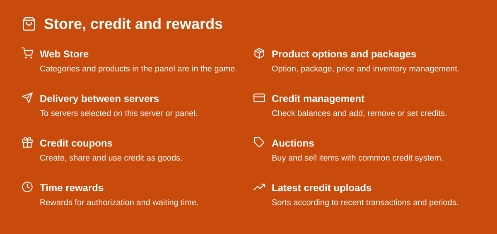
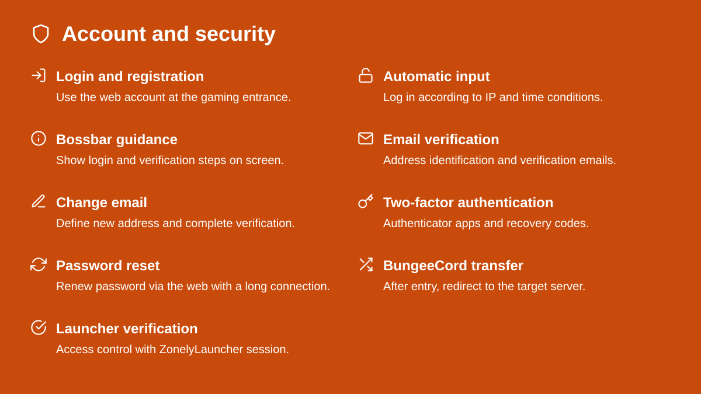
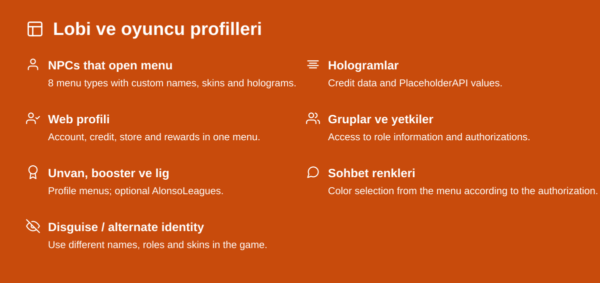
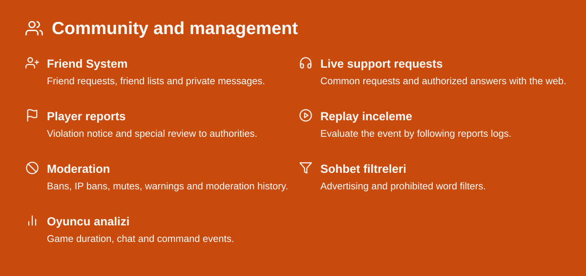
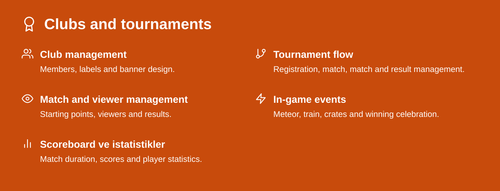
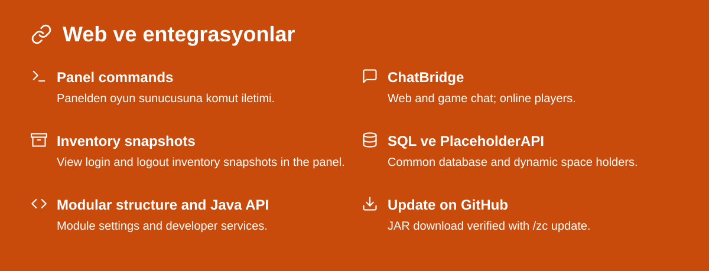
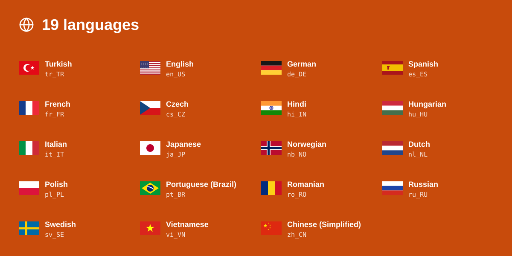

Connect your Minecraft server to your Zonely website and manage your store, accounts, players and tournaments together.

**Introduction video:** [Watch on YouTube](https://www.youtube.com/watch?v=qQuz-bhDHg4)

[Download JAR](https://github.com/zonely-gen-tr/ZonelyCore/releases/latest) · [Installation](docs/KURULUM.md) · [Store](docs/MAGAZA.md) · [API](docs/ZonelyCoreAPI.md) · [SpigotMC](https://www.spigotmc.org/resources/zonelycore-one-core-for-minecraft.129652/) · [Support](https://github.com/zonely-gen-tr/ZonelyCore/issues)








[Detailed system reference](docs/SISTEMLER.md)



The default language is `tr_TR`. Configure languages and messages in `languages.yml`.

## Installation

Requirements: the Zonely web panel, MySQL/MariaDB, ProtocolLib and PlaceholderAPI.

1. [Download the JAR](https://github.com/zonely-gen-tr/ZonelyCore/releases/latest) and place it in `plugins/`.
2. Enter the panel database credentials in `config.yml`.
3. Enable the modules you need and restart the server.

For store integration, set `web-token` to the token assigned to this server in the panel, then configure products and delivery commands. This field is optional for installations that do not use the store.

Test environment: **Paper 1.20.4 · Java 21 · ProtocolLib 5.4.0 · PlaceholderAPI 2.11.6**.

[Installation guide](docs/KURULUM.md) · [Store and cross-server delivery](docs/MAGAZA.md) · [GitHub updates](docs/GUNCELLEME.md)

## Commands and NPCs

| Command | Purpose |
| --- | --- |
| `/zc` | Administration help. |
| `/zc reload` | Reload configuration files. |
| `/zc update` | Check GitHub for updates and download a release. |
| `/zc npc spawn <type> [id]` | Create a lobby NPC. |
| `/zc npc remove <type> [id]` | Remove a lobby NPC. |
| `/zc hologram lastcredits [id]` | Create a recent-credit hologram. |
| `/webprofile` | Open a player profile. |
| `/store` · `/magaza` · `/zonelystore` | Open the store. |
| `/credit [player]` | Check a credit balance. |
| `/credit set/add/remove <player> <amount>` | Manage credits. |
| `/creditvoucher <player> <amount>` | Create a credit voucher. |
| `/lastcredits` | Recent credit top-ups and rankings. |
| `/auction <amount>` | Auction the held item. |
| `/auctions` | Browse auctions. |
| `/report <player>` · `/reports` | Submit and review player reports. |
| `/punish` | Open the moderation menu. |
| `/punish ban/ipban/mute/warning <player> <duration> <reason>` | Apply a moderation action. |
| `/punish unban/unmute/unwarning <player>` | Remove the corresponding action. |
| `/support` | Support tickets. |
| `/friends` | Friends menu. |
| `/friends add/accept/deny/remove <player>` | Manage friends and requests. |
| `/friends msg <player> <message>` | Send a private message. |
| `/disguise` | Alternate identity menu. |
| `/club` · `/club help` | Clubs and command help. |
| `/esports` | Tournaments and administration. |
| `/login` · `/register` | Login and registration. |
| `/email <set\|resend\|status>` | Email settings and verification. |
| `/passwordreset` | Password reset. |
| `/2fa <setup\|confirm\|cancel\|disable\|code\|recovery>` | Two-factor authentication. |

NPC types: `web-profile`, `auctions`, `last-credits`, `reports`, `deliveries`, `web-store`, `supports`, `tournaments`.

```text
/zc npc spawn web-store store
/zc npc spawn web-profile profile
/zc npc spawn tournaments tournaments
/zc hologram lastcredits credits
```

<details>
<summary>Placeholder reference</summary>


Use these placeholders in scoreboards, menus and hologram plugins. In recent-credit placeholders, `<sıra>` is the record position, starting at `1`. Values may be empty when there is no matching record or active tournament.

### General and credit areas

| Placeholder | Value |
| --- | --- |
| `%ZonelyCore_cash%` | Credits bakiyesi. |
| `%ZonelyCore_perm%` | Player role/grubu. |
| `%ZonelyCore_playername%` | Shown player name. |
| `%ZonelyCore_status_delivery%` | Expected time prize information. |
| `%ZonelyCore_lastcredit_<sıra>%` | The player name of the corresponding record. |
| `%ZonelyCore_lastcredit_<sıra>_display%` | Player and load amount. |
| `%ZonelyCore_lastcredit_<sıra>_name%` | Player name. |
| `%ZonelyCore_lastcredit_<sıra>_amount%` | Uploaded credit. |
| `%ZonelyCore_lastcredit_<sıra>_date%` | Loading date. |
| `%ZonelyCore_lastcredit_<sıra>_time%` | Loading time. |

<details>
<summary>Tournament, Club and match placeholders</summary>

```text
%zonely_tournament_name%
%zonely_tournament_state%
%zonely_tournament_event%
%zonely_tournament_start%
%zonely_tournament_end%
%zonely_tournament_club_count%
%zonely_tournament_countdown%
%zonely_tournament_countdown_seconds%
%zonely_tournament_register_open%
%zonely_tournament_repeatable%
%zonely_tournament_repeat_days%
%zonely_tournament_repeat_mode%
%zonely_club_name%
%zonely_club_tag%
%zonely_club_seed%
%zonely_club_status%
%zonely_next_match_round%
%zonely_next_match_slot%
%zonely_next_match_a%
%zonely_next_match_b%
%zonely_active_match_id%
%zonely_match_time%
%zonely_match_id%
%zonely_match_players%
%zonely_match_kills%
%zonely_match_deaths%
%zonely_match_blocks%
%zonely_match_clubkills%
%zonely_match_clubkills_<TAG>%
```

A part of match statistics is special to the player. In areas used with club tag `<TAG>` instead of written the label of the corresponding club.


</details>

## Placeholders and developer API

The complete placeholder reference is available in the [system guide](docs/SISTEMLER.md). Some match statistics are player-specific. Replace `<TAG>` with the club tag in club-related placeholders.

Add `ZonelyCore` as a dependency and access `ZonelyCoreAPI.get()` after the plugin is enabled.

```java
import dev.zonely.whiteeffect.api.ZonelyCoreAPI;

ZonelyCoreAPI api = ZonelyCoreAPI.get();
long balance = api.cash().getBalance("Player");
```

| Service | Purpose |
| --- | --- |
| `api.cash()` | Balance queries and credit operations. |
| `api.vouchers()` | Create, read and redeem vouchers. |
| `api.deliveries()` | Scheduled rewards and claim status. |
| `api.lastCredits()` | Recent top-ups and ranking cache. |
| `api.auctions()` | Auction screens and data access. |
| `api.socket()` | Panel connection status and control. |

[API guide](docs/ZonelyCoreAPI.md) · [Build from source](docs/GELISTIRME.md)

[MIT license](LICENSE) · [Third-party licenses](THIRD_PARTY_NOTICES.md) · [Zonely](https://zonely.gen.tr)
