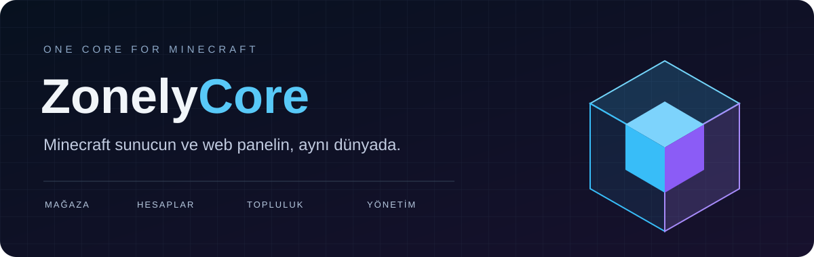

<div align="center">



**Web mağazası · Oyuncu hesapları · Lobi deneyimi · Sunucu yönetimi**

[](CHANGELOG.md)
[](LICENSE)
[](https://www.spigotmc.org/resources/zonelycore-one-core-for-minecraft.129652/)
[](docs/KURULUM.md)

[Kurulum](docs/KURULUM.md) · [Mağaza ayarları](docs/MAGAZA.md) · [Güncelleme notları](CHANGELOG.md) · [Geliştirici API](docs/ZonelyCoreAPI.md) · [Hata bildir](https://github.com/zonely-gen-tr/ZonelyCore/issues)

</div>

---

## Sunucun ile web siten birlikte çalışsın

ZonelyCore, Zonely web panelini Minecraft sunucuna bağlar. Oyuncular web hesaplarıyla giriş yapabilir, site kredileriyle oyun içinden alışveriş yapabilir ve profillerine ulaşabilir. Yetkililer destek taleplerini, raporları ve cezaları oyun içinden yönetebilir.

Mağaza içeriğini panelden düzenle; oyuncuna kategori, ürün ve seçenek menüleriyle sun. Aynı ürünün farklı sunuculardaki teslimat komutlarını panelden tanımla. Her ZonelyCore sunucusu kendi teslimat kuyruğunu işler.

## Neler sunar?

| Alan | Oyuncuların ve ekibin kullanabileceği özellikler |
| --- | --- |
| **Mağaza ve ekonomi** | Web mağazası, ürün seçenekleri, paketler, kredi bakiyesi, kredi kuponları, açık artırmalar ve zamanlı ödüller. |
| **Hesap ve giriş** | Web hesabıyla giriş/kayıt, IP üzerinden otomatik giriş, e-posta doğrulama, TOTP 2FA ve şifre sıfırlama akışı. |
| **Lobi ve profiller** | Menü açan NPC'ler, hologramlar, son kredi yüklemeleri, web profili, gruplar, unvanlar, sohbet renkleri ve disguise menüleri. |
| **Topluluk ve yönetim** | Arkadaşlar, destek talepleri, oyuncu raporları, replay, ceza yönetimi ve sohbet filtreleri. |
| **E-spor ve kulüpler** | Kulüp kaydı, turnuva eşleşmeleri, bekleme lobisi, maç aşamaları, izleyiciler ve arena etkinlikleri. |
| **Web ve ağ bağlantısı** | Panel komutları, ChatBridge, envanter görüntüleri, launcher kimlik doğrulaması ve BungeeCord aktarımı. |
| **Özelleştirme** | `languages.yml` üzerinden metinler, menü başlıkları ve lore; PlaceholderAPI ve Java API desteği. |

Özelliklerin bir bölümü panel yapılandırması, ek bağımlılıklar veya ilgili modülün etkin olmasını gerektirir. ZonelyCore, **Zonely Minecraft web paneliyle birlikte** çalışmak üzere geliştirilmiştir.

## 5.0.1'de öne çıkanlar

- `/zc` ve menülerde dil dosyası erişiminden kaynaklanan gereksiz disk işlemleri azaltıldı.
- Mağaza açıklamaları satırlara bölündü; Türkçe karakter, HTML ve bozulmuş metin gösterimleri düzenlendi.
- Satın alma; bakiye, stok, sipariş ve teslimat kayıtlarını birlikte işler. Aynı işlem kimliğinin tekrarında ikinci kez ücret alınmaz.
- Satın alınan ürünler için paneldeki sunucu/komut eşlemeleri teslimat kuyruğuna aktarılır.
- NPC/hologram metadata ve oyuncu kafası uyumluluğuna yönelik düzeltmeler eklendi.
- Güncelleme kontrolü ve JAR indirmesi **GitHub Releases** üzerinden, sunucunun ana iş parçacığını bekletmeden yapılır.

[Tüm değişiklikleri ve geçiş notlarını oku →](CHANGELOG.md)

## Hızlı kurulum

1. Zonely Minecraft web panelini ve veritabanını hazırla.
2. Sunucu sürümüne uygun **ProtocolLib** ve **PlaceholderAPI** eklentilerini kur.
3. Hazır ZonelyCore JAR dosyasını `plugins/` klasörüne koy ve sunucuyu başlat.
4. `plugins/ZonelyCore/config.yml` dosyasına veritabanı bilgilerini ve panelde bu sunucu için oluşturduğun `web-token` değerini yaz.
5. Panelde ürün, kategori ve teslimat komutlarını yapılandır; sunucuyu yeniden başlat.

**Bu düzeltmelerin doğrulandığı ortam:** Paper **1.20.4 build 499**, Java **21**, ProtocolLib **5.4.0**, PlaceholderAPI **2.11.6**.

[Ayrıntılı kurulum →](docs/KURULUM.md)

## Tek sunucu veya tüm ağ

```yaml
web-token: "BU_SUNUCU_ICIN_PANELDEKI_TOKEN"
store:
  # false: Bu sunucuya ait komutlar. true: Panelde seçili diğer sunuculara da teslimat.
  send-to-other-servers: false
  # Oyuncu hedef sunucuya girene kadar teslimatı bekletir.
  require-player-online: true
```

Mağaza için ayrıca `store.server-id` girilmez. Sunucu, kendi `web-token` değeriyle panel kaydı üzerinden eşleşir. Ağdaki her sunucuya **farklı token** tanımlanmalıdır. `send-to-other-servers: true` kullanıldığında hedef sunucuların da ZonelyCore çalıştırması ve kendi panel kayıtlarıyla eşleşmesi gerekir.

> **Ürün görünmüyor mu?** Panelde kategorinin, üst kategorilerin ve ürün/seçeneğin **Oyunda Göster** ayarını kontrol et. Gizli ürünler otomatik olarak görünür yapılmaz. [Mağaza rehberi →](docs/MAGAZA.md)

## Sık kullanılan komutlar

| Komut | İşlev |
| --- | --- |
| `/zc` · `/zc reload` | Yönetim yardımı ve yapılandırmayı yeniden yükleme. |
| `/zc update` | GitHub'dan sürümü kontrol etme; yeni sürüm varsa indirme. |
| `/store` · `/magaza` · `/zonelystore` | Oyun içi mağazayı açma. |
| `/webprofile` · `/lastcredits` | Profil ve son kredi yüklemeleri. |
| `/credit` · `/creditvoucher` | Kredi bakiyesi ve kredi kuponları. |
| `/auctions` · `/auction <tutar>` | Açık artırma menüsü ve eldeki eşyayı satışa koyma. |
| `/report <oyuncu>` · `/reports` · `/punish` | Raporlar ve ceza yönetimi. |
| `/support` · `/friends` | Destek ve arkadaş menüleri. |
| `/esports` · `/club` | Turnuva ve kulüp yönetimi. |

Yönetim işlemleri ilgili yetkileri gerektirir; `/zc` için `zcore.admin` kullanılır.

<details>
<summary><strong>NPC, hologram ve PlaceholderAPI örnekleri</strong></summary>

```text
/zc npc spawn web-store magaza
/zc npc spawn web-profile profil
/zc npc spawn last-credits krediler
/zc hologram lastcredits krediler
```

```text
%ZonelyCore_cash%
%ZonelyCore_playername%
%ZonelyCore_lastcredit_1_name%
%ZonelyCore_lastcredit_1_amount%
```

Yer tutucularda gösterilebilecek kayıt yoksa ilgili alanın boş olması normaldir.

</details>

## GitHub üzerinden güncelleme

Eklenti, bu deponun **son yayımlanmış kararlı Release** kaydını kontrol eder. Kaynak koduna commit atmak tek başına oyunculara güncelleme göndermez. Yayına `v5.0.1` gibi bir etiket ve `ZonelyCore-5.0.1.jar` veya `ZonelyCore.jar` adlı derlenmiş dosya eklenir.

`/zc update`, dosyayı doğrulayıp Bukkit'in güncelleme klasörüne mevcut eklenti dosyası adıyla hazırlar. Değişiklik **sunucu yeniden başlatılınca** uygulanır. Eski web adreslerini kullanan sürümlerden ilk geçişte JAR elle değiştirilmelidir.

[Güncelleme ve yayın kuralları →](docs/GUNCELLEME.md)

## Geliştiriciler için

Kaynak kodu Maven ile derlenir. Bazı sunucu ve eklenti API'leri yerel JAR bağımlılığı olduğundan temiz bir klonda yalnızca `mvn package` çalıştırmak yeterli değildir. Gerekli dosyalar ve test adımları [geliştirme rehberindedir](docs/GELISTIRME.md).

```java
import dev.zonely.whiteeffect.api.ZonelyCoreAPI;

ZonelyCoreAPI api = ZonelyCoreAPI.get();
long bakiye = api.cash().getBalance("Oyuncu");
```

## Lisans ve bağlantılar

Zonely tarafından geliştirilen kod **[MIT lisansı](LICENSE)** altında sunulur. [Üçüncü taraf kodları ve bağımlılıklar](THIRD_PARTY_NOTICES.md) kendi lisanslarına tabidir. Web paneli ve diğer Zonely ürünleri bu deponun lisansına dahil değildir.

[Zonely](https://zonely.gen.tr) · [SpigotMC](https://www.spigotmc.org/resources/zonelycore-one-core-for-minecraft.129652/) · [GitHub Releases](https://github.com/zonely-gen-tr/ZonelyCore/releases) · [Destek / hata bildirimi](https://github.com/zonely-gen-tr/ZonelyCore/issues)

<div align="center"><sub>WhiteEffect · Orçun Dönmez · Zonely</sub></div>
